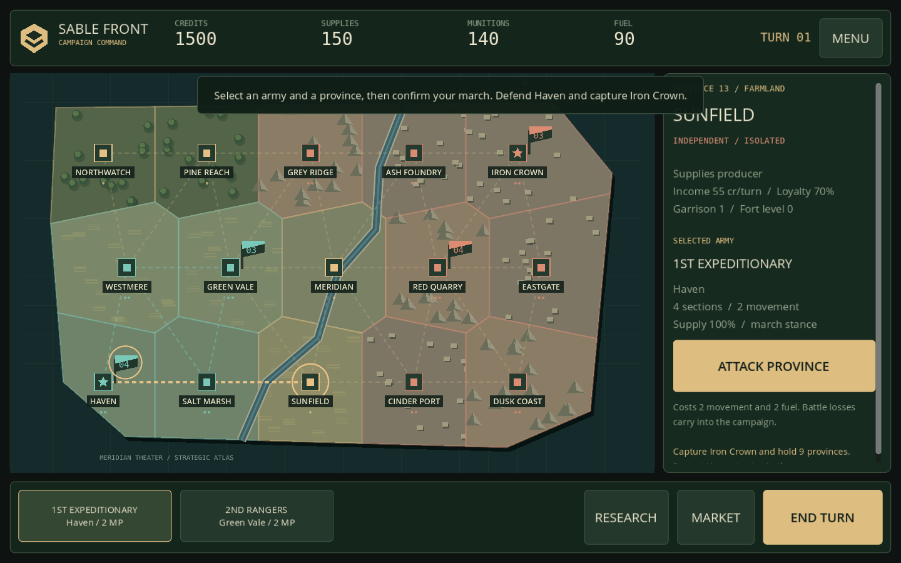
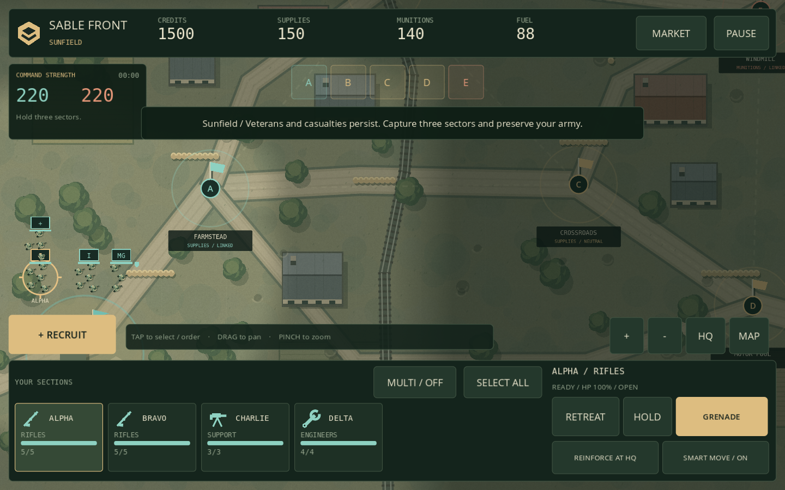

# Sable Front — Campaign Edition 0.2.0

An original, offline Godot squad RTS for landscape Android play.

## Download

- [Android APK — version 0.2.0](https://github.com/jhonshepherddelsocorro-spec/Mobile-rts/raw/refs/heads/downloads/SableFront-android.apk?download=1&version=0.2.0)
- [Godot project source ZIP](https://github.com/jhonshepherddelsocorro-spec/Mobile-rts/raw/refs/heads/downloads/SableFront-godot-source.zip?download=1&version=0.2.0)
- [SHA-256 checksums](SHA256SUMS.txt)

Download the APK in your browser and open it to install. Requires Android 7.0+, ARM32/ARM64, and OpenGL ES 3.0. Version 0.2 uses the same package and signing certificate as 0.1, so it can install as an update while retaining local skirmish saves. This is a development-signed build.

## What changed

- A 15-province regional campaign: march armies, invade provinces, defend your capital, and capture Iron Crown and nine provinces to win.
- Two starting armies, up to four allied armies, persistent casualties, veteran experience and tactical recruits returning to the strategic roster.
- Garrisons, industry, forts, supply depots, multi-turn research, army stances, supply isolation and attrition.
- Separate provincial markets with changing stock, demand, prices and price history.
- Twelve unit roles, including medics, pathfinders, marksmen, mortars, anti-tank guns, tanks and flame pioneers, with distinct abilities.
- Tactical AI that seeks cover, supports advances, flanks, retreats and recruits armor counters; strategic AI that moves armies and spends a finite budget.
- Larger touch controls, group selection, a collapsible minimap, jitter-resistant gestures, Android safe-area handling, 30/60 FPS and reduced-effects settings, and optional haptics.
- New original unit artwork, textured terrain, smooth fog, animated water and five tactical biomes with actual terrain differences.
- Atomic saves of the campaign and active or completed battles, including unit identities, injuries, deployment state, smoke and veteran experience.

## Start playing

Choose **New Campaign**. Select an army card, tap a province, then confirm **March Here** or **Attack Province**. Use **Command Battle** to fight directly or **Auto Resolve** to resolve with persistent casualties. End Turn advances production, research, construction and enemy armies. The Commander's Manual explains the full controls.

For a standalone match, choose **Quick Skirmish**. During battle, tap a section card and then the map, drag to pan and pinch to zoom. **MULTI** toggles group selection. **MAP** opens the tactical overview. **Retreat** saves veterans and **Reinforce at HQ** replaces losses.

To edit the game, extract the source ZIP, import `SableFront/project.godot` in Godot 4.6.3, and run it. The source contains the full manual, validation notes, original art/sound generators, and five automated suites.

## Verification

**853 automated assertions passed across five suites.** Seven standalone matches and one actual campaign battle completed with real simulation and AI. Native touch tests exercised the complete campaign-to-battle flow, including background pause, save/resume, withdrawals and result commitment. The exported browser build also saved a campaign battle, reloaded the page, resumed it and returned the result to the campaign with no browser errors.

APK signature schemes v2/v3, native-library 16 KB alignment, and matching update certificate were verified. The only requested Android permission is vibration; Internet permission is not requested.

**Physical Android device testing remains pending.** Installation, device-specific GPU/audio/haptic behavior, cutouts, thermal/battery use and mobile frame rate are not certified. This is an offline single-player campaign version; multiplayer and diplomacy are outside 0.2.

Made with [Godot Engine](https://godotengine.org/) ([license](https://godotengine.org/license/)). Game code and original assets are MIT-licensed; bundled font notices are included.
